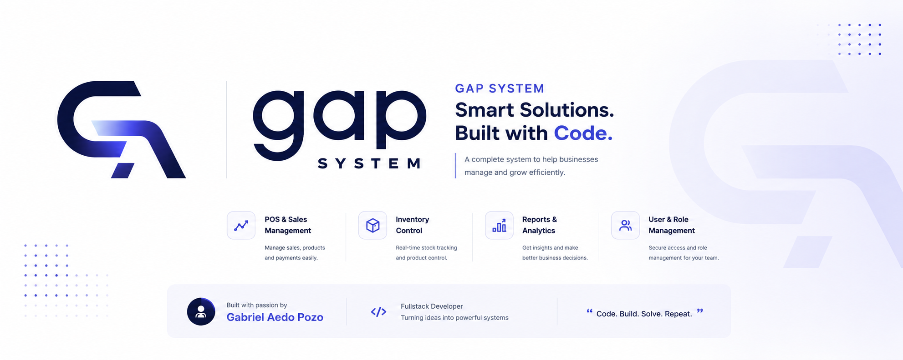

  

<h1 align="center">Hi, I'm Gabriel Aedo 👋</h1>

💻 Fullstack Developer | 🧠 Learning Every Day | 🇵🇪 Lima, Peru

---

### 🎯 About Me
I'm an enthusiastic frontend developer who started programming 2 year ago. I discovered the world of frontend development — and I loved it. Since then, I haven’t stopped learning.  
I enjoy building beautiful, functional, and fast websites using HTML, CSS, JavaScript, Astro, and Tailwind CSS.  
Currently, I’m learning React, SQL, and Next.js because I want to keep growing and eventually become a full-stack developer.  
I’m very curious, self-taught, and passionate about every project I build. I love helping others, sharing what I learn, and collaborating with teams.

---

### 🧑‍💻 More About Me
- 🔥 Passionate about technology and web development  
- 🧩 I love solving problems with code  
- 📚 Currently learning **NextJS** and *SQL*  
- 🎯 My goal: to become an expert full-stack developer  
- 💼 Working as a freelancer for small businesses  
---

### 🚀 Technologies I Use

---

### 📫 Contact
- ✉️ **aedothegabriel@gmail.com**  
- 💼 [LinkedIn](https://www.linkedin.com/in/tu-perfil)  
- 🌐 [Portfolio](https://gabriel-aedo.pages.dev/)  
> 💬 *"All you need is a computer and the will to learn."*
